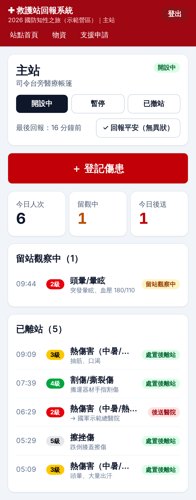
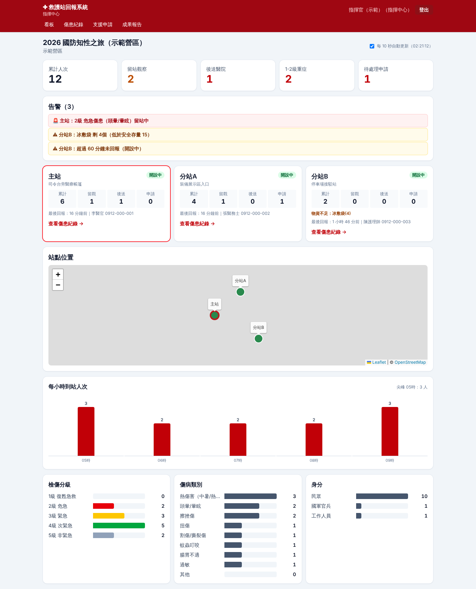

# 救護站資訊回報系統（國防知性之旅）

國防知性之旅活動現場救護站的即時回報網站：站點人員用手機掃 QR Code 登記傷患、回報物資與申請支援，指揮中心在看板上即時掌握各站狀況，活動結束後一鍵產出成果報告。

| 站點人員（手機） | 指揮中心看板 |
|---|---|
|  |  |

**正式網址：** https://ems-report--ems-report-29cc5.asia-east1.hosted.app

## 功能

**站點人員**（掃描站點 QR Code 登入，不需帳號）
- 登記傷患：到站時間、身分（民眾／國軍官兵／工作人員）、性別、年齡層、TTAS 檢傷 1–5 級、傷病類別、主訴、處置、去向（留觀／離站／後送／拒絕就醫）、後送醫院與車號
- 留觀中的傷患置頂，可隨時更新去向
- 切換站點狀態（開設／暫停／撤站）、「回報平安」
- 物資存量 ± 調整，低於安全存量自動通知指揮中心
- 支援申請（人力／物資／救護車），可標示緊急，並看到指揮中心回覆

**指揮中心**
- 即時看板（每 10 秒自動更新）：累計人次、留觀、後送、1–2 級重症、待處理申請
- 告警：重症留站、緊急申請、近 30 分鐘後送、物資不足、站點超過 60 分鐘未回報
- 各站狀態卡片、站點地圖（OpenStreetMap）、每小時人次、檢傷／傷病類別／身分分布
- 傷患紀錄查詢與篩選、匯出 CSV（Excel 可直接開啟）
- 支援申請處理與回覆
- 成果報告頁（可列印或存成 PDF）

**系統管理員**
- 活動場次管理（可重複用於不同營區）
- 救護站管理、列印站點 QR Code、QR Code 外流時一鍵重新產生（舊的立即失效）
- 指揮中心／管理員帳號管理
- 操作紀錄（誰在什麼時間做了什麼）

## 個資與安全

- 傷患資料**不收姓名、身分證、電話**，只記錄統計所需欄位
- 密碼以 bcrypt 雜湊；登入失敗 5 次鎖 10 分鐘
- Session 為簽章的 HttpOnly Cookie；每次請求都向資料庫確認帳號仍有效、QR Code 未被重新產生
- 伺服器端逐一檢查角色與站點歸屬：站點人員只能看到、修改自己站的資料
- CSV 匯出防公式注入，匯出動作寫入操作紀錄
- 正式環境請務必使用 HTTPS

## 技術架構

Next.js 15（App Router、Server Actions）＋ TypeScript ＋ **Cloud Firestore**（firebase-admin）＋ Tailwind CSS 4，部署在 **Firebase App Hosting**。測試使用 Vitest（單元）與 Playwright（端對端，搭配 Firestore 模擬器）。

- 所有資料都由網站伺服器透過 Admin SDK 讀寫，瀏覽器不直接連 Firestore；`firestore.rules` 禁止所有用戶端存取
- 查詢只用單一欄位條件，不需要建立任何 Firestore 複合索引

Firestore 集合：`events`（場次）、`stations`（救護站）、`users`（帳號）、`patients`（傷患）、`supplies`（物資）、`requests`（支援申請）、`auditLogs`（操作紀錄）。

```
src/app/station/   站點人員頁面（手機版）
src/app/command/   指揮中心：看板、傷患紀錄、支援申請、成果報告
src/app/admin/     系統管理：場次、救護站、QR Code、帳號、操作紀錄
src/app/join/      QR Code 登入
src/lib/repo.ts    Firestore 資料存取
src/lib/           權限、session、驗證、統計與告警邏輯、選項定義
scripts/seed.ts    建立示範資料
tests/unit/        單元測試
tests/e2e/         端對端測試
apphosting.yaml    App Hosting 設定
```

> 要調整表單的選項（例如對齊既有的 Google 表單），修改 `src/lib/constants.ts` 即可。

## 部署到 Firebase（App Hosting + Firestore）

前置條件：Firebase 專案已建立 **Cloud Firestore**（預設資料庫 `(default)`），並升級為 **Blaze 方案**（App Hosting 需要；活動規模的用量通常在免費額度內）。

**1. 在 Firebase 主控台建立 App Hosting 後端**

「建構 → App Hosting → 開始使用」，連結 GitHub 儲存庫 `paul25042505/ems-report`，根目錄 `/`、正式版分支 `main`，後端名稱填 `ems-report`，區域選 `asia-east1`（台灣）。第一次部署會因為還沒設定 Secret 而失敗，沒關係。

**2. 設定兩個 Secret**（在本機專案資料夾執行）

```bash
npm install
npx firebase login
npx firebase use <你的專案ID>
npx firebase apphosting:secrets:set ems-session-secret    # 貼上 openssl rand -base64 32 產生的亂數
npx firebase apphosting:secrets:set ems-admin-password    # 初始管理員密碼（至少 8 碼）
```

詢問是否授權給後端時選 `ems-report`；若沒問到，執行：

```bash
npx firebase apphosting:secrets:grantaccess ems-session-secret,ems-admin-password --backend ems-report
```

> 也可以不連 GitHub，直接從本機部署：`npx firebase deploy --only apphosting,firestore:rules`（`firebase.json` 已設定後端 `ems-report`）。

**3. 重新部署**

主控台 App Hosting → `ems-report` →「建立推出作業（rollout）」，或推送任何 commit 到 `main` 會自動部署。

**4. 開始使用**

打開後端網址（`https://ems-report--<專案ID>.<區域>.hosted.app`），以 `admin` 和步驟 2 的密碼登入（第一次登入會自動建立管理員），到「系統管理」建立場次與救護站、列印 QR Code。

**（選用）部署安全規則**：`npx firebase deploy --only firestore:rules`。以「正式版模式」建立的 Firestore 預設已禁止用戶端存取。

> 若網站出現 Firestore 權限錯誤，到 Google Cloud 主控台 IAM，給 App Hosting 的服務帳號（`firebase-app-hosting-compute@<專案ID>.iam.gserviceaccount.com`）加上「Cloud Datastore 使用者」角色。
> 使用非預設的 Firestore 資料庫時，在 `apphosting.yaml` 加上環境變數 `FIRESTORE_DATABASE_ID`。

### 備份

在指揮中心「傷患紀錄」匯出 CSV；或用 Firestore 的匯出／排程備份功能。

## 本機開發

需要 Node.js 22 與 Java 11 以上（Firestore 模擬器）。

```bash
npm install
cp .env.example .env            # 編輯 ADMIN_PASSWORD
npm run dev                     # 啟動 Firestore 模擬器、寫入示範資料，http://localhost:3000
```

本機資料存在模擬器的記憶體中，停止後即清除，不會動到正式的 Firestore。

示範帳號：
- 管理員：`admin` ／ `.env` 中的 `ADMIN_PASSWORD`
- 指揮中心：`command` ／ `command1234`
- 站點人員：啟動時會印出各站的 `/join/...` 網址，也可以在「系統管理 → 救護站 → 編輯／QR Code」取得

## 測試

```bash
npm run lint
npm run typecheck
npm test                        # 單元測試
npm run test:e2e                # 端對端測試（自動啟動 Firestore 模擬器、build 並啟動服務）
```

## 環境變數

| 變數 | 說明 |
|---|---|
| `SESSION_SECRET` | Session 簽章金鑰，正式環境必填、至少 32 字元（App Hosting 用 Secret `ems-session-secret`） |
| `ADMIN_USERNAME` / `ADMIN_PASSWORD` | 資料庫沒有任何帳號時，第一次登入建立的初始管理員（密碼用 Secret `ems-admin-password`） |
| `FIRESTORE_DATABASE_ID` | 選填，非預設的 Firestore 資料庫 ID |
| `PUBLIC_URL` | 選填，QR Code 使用的對外網址；預設以瀏覽器存取的網址產生 |
| `INSECURE_COOKIE` | 選填，設為 `1` 允許在 HTTP 下登入（僅限測試） |

## 後續可擴充

- 離線暫存（PWA）：收訊不佳時先存在手機，恢復連線自動上傳
- 告警推播（LINE／Telegram）
- 對齊既有 Google 表單欄位
